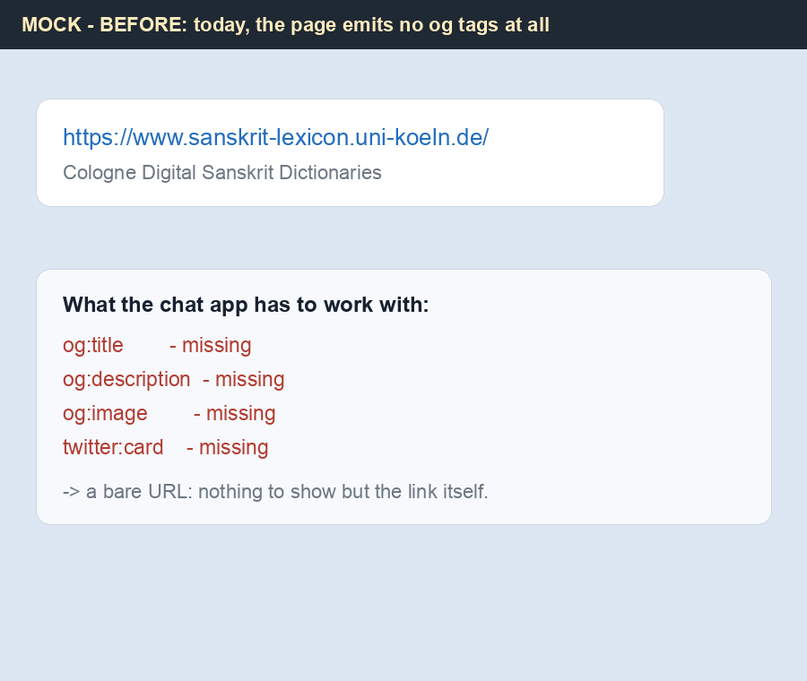

# Deploy request — autogenerated Open Graph previews on every page surface (H7901)

_Created: 09-11-2026 · Last updated: 09-11-2026_

For: Jim (Cologne host admin) · From: csl-apidev maintainers · Scope: pull the
H7901 checkouts so every page of the live site serves Open Graph / Twitter-card
meta. Nothing beyond the normal checkout pull — no Apache or PHP config, no new
routes, no cron to add, no downtime. Sibling of the
[DEPLOY_REQUEST_JIM.md](https://github.com/sanskrit-lexicon/csl-apidev/blob/main/doc/ux-redesign/DEPLOY_REQUEST_JIM.md)
(sitemap/robots) request; the entry-page half of this programme is **already
live** (H6478, re-probed below).

## What this gives — visual examples

The three images below are **mocks** (labelled as such), rendered from the real
emitted tags: the AFTER strings are verbatim `og:title` / `og:description`
values from the local render probes, and the picture is the actual committed
card `og/site_card.png`.

**Today (BEFORE)** — the site emits zero og tags, so a shared link is a bare URL:



**After the pulls (AFTER)** — the homepage, rich preview with the site card:


**After the pulls (AFTER)** — a dictionary landing, description composed from
the dictionary's registry row (name · author · entry count):


The same card then appears in Telegram, Slack, X, Facebook, WhatsApp, iMessage,
Discord and LinkedIn shares; entry pages already do this today (H6478).

## What we expect from Jim

Four checkouts (three required, one optional), each a plain `git pull`:

| # | Checkout (host path) | What it turns on | Command |
|---|---|---|---|
| 1 | `csl-apidev` at `scans/awork/apidev/` | listview, sample listview, simple-search, scan-image views (`servepdf`), **and** the site card `og/site_card.png` that every preview's `og:image` points at | `git pull` |
| 2 | `csl-websanlexicon` (the generator checkout) | all 45 dictionary apps: old-style landing pages, list displays, scan views — these are *generated* trees, so after the pull let the existing server-side cron refresh run, or run it once for immediacy: `sh v02/redo_cologne_all.sh` (regenerates in place; data files are untouched — the generator only writes what `inventory.txt` names) | `git pull` + refresh |
| 3 | `csl-homepage` | the site homepage `index.html`: regenerate and place at the docroot — `sh redo_cologne.sh` (it reads `../csl-orig/.version`, present on the host) | `git pull` + `sh redo_cologne.sh` |
| 4 | *(optional, same day)* `csl-westergaard`, `csl-whitroot`, `csl-kale`, `csl-inflect` (the `/scans/csl-*` checkouts) | the newer-style scan landings and the inflected-form lookup page | `git pull` each |

Merged PRs this pulls in — all CI-green:

- [csl-websanlexicon#171](https://github.com/sanskrit-lexicon/csl-websanlexicon/pull/171) (canonical `og_meta.php` + templates, merged first)
- [csl-apidev#187](https://github.com/sanskrit-lexicon/csl-apidev/pull/187) (byte-identical twin + wired surfaces + this manual, merged second)
- [csl-homepage#31](https://github.com/sanskrit-lexicon/csl-homepage/pull/31)
- [csl-westergaard#12](https://github.com/sanskrit-lexicon/csl-westergaard/pull/12) · [csl-whitroot#11](https://github.com/sanskrit-lexicon/csl-whitroot/pull/11) · [csl-kale#13](https://github.com/sanskrit-lexicon/csl-kale/pull/13) · [csl-inflect#40](https://github.com/sanskrit-lexicon/csl-inflect/pull/40)

## What it requires

- **Time:** ~5–10 minutes total; step 2's refresh is the only part that runs
  longer (it already runs unattended via cron on its normal schedule —
  [WEB_FRONTEND_MANUAL §2/§4.4](https://github.com/sanskrit-lexicon/csl-websanlexicon/blob/main/docs/WEB_FRONTEND_MANUAL.md)).
- **Config:** none. No Apache/PHP changes, no new routes, no new cron entries,
  no services restarted. Every change is additive PHP/HTML inside existing
  checkouts.
- **Downtime:** none. Pages keep serving during the pull; the new include is
  loaded per-request like any other PHP file.
- **Dependencies:** none new — `og_meta.php` is plain PHP (core functions
  only), the homepage generator is the same Python script that already builds
  `index.html`.
- **Rollback (if ever needed):** `git reset --hard <pre-pull SHA>` in the
  affected checkout, then re-run step 2's refresh for the generator trees.
  Everything is regenerable; nothing here touches data files or databases.
- **Risk:** the normal pull risk only. Every PR above merged with green CI
  (PHP syntax lint, Python+Mako compile, Semgrep, CodeQL, YAML lint; the
  apidev twin additionally with the **twin-drift guard** proving byte-identity
  of `og_meta.php` against csl-websanlexicon).

## Before-state (live re-probe, 09-11-2026 ~19:40 MSK)

| Probe | Observed |
|---|---|
| `https://www.sanskrit-lexicon.uni-koeln.de/` (homepage) | **0** og/twitter tags |
| `…/scans/MWScan/2012/web/index.php` (old-style dict landing) | **0** og/twitter tags |
| `…/scans/csl-westergaard/disp/index.php` (newer-style landing) | **0** og/twitter tags |
| `…/scans/awork/apidev/getword.php?dict=mw&key=harika…` (entry page, H6478) | **5** og/twitter tags — already live |
| `…/scans/awork/apidev/og/site_card.png` (the preview card) | **404** — resolves after step 1 |

Re-probe commands (post-deploy validation reuses them):

```bash
B=https://www.sanskrit-lexicon.uni-koeln.de
curl -s "$B/"                                     | grep -c 'og:title'   # before: 0
curl -s "$B/scans/MWScan/2012/web/index.php"      | grep -c 'og:title'   # before: 0
curl -s "$B/scans/csl-westergaard/disp/index.php" | grep -c 'og:title'   # before: 0
curl -s -o /dev/null -w '%{http_code}\n' "$B/scans/awork/apidev/og/site_card.png"  # before: 404
```

If any probe disagrees with this table (for instance a surface already carrying
og tags, or a checkout living at a different host path), **stop and report**
rather than adjusting paths — see Escalation.

## Post-deploy validation

Mechanical (every command + expected value):

```bash
B=https://www.sanskrit-lexicon.uni-koeln.de
curl -s "$B/"                                     | grep -c 'og:title'          # 1
curl -s "$B/scans/MWScan/2012/web/index.php"      | grep -c 'og:title'          # 1
curl -s "$B/scans/csl-westergaard/disp/index.php" | grep -c 'og:title'          # 1 (after step 4)
curl -s "$B/scans/awork/apidev/listview.php?dict=mw" | grep -c 'og:title'       # 1
curl -s "$B/scans/awork/apidev/simple-search/v1.0/list-0.2s_rw.php" | grep -c 'og:title'  # 1
curl -s "$B/scans/awork/apidev/servepdf.php?dict=mw&page=0001" | grep -c 'og:title'       # 1
curl -s -o /dev/null -w '%{http_code}\n' "$B/scans/awork/apidev/og/site_card.png"         # 200
```

Then the human eyeball (~2 minutes): share any one of those URLs in Telegram
and confirm the rich preview (image + title + description) instead of a bare
link. Note: chat apps cache previews per URL — a *new* share of the same URL
re-fetches immediately.

## Escalation

Stop and report instead of improvising when: a before-state probe disagrees
with the table above; a checkout path differs from the assumption in step 1–4;
the refresh in step 2 fails its own run; or any post-deploy probe is not its
expected value. Rollback for any step is `git reset --hard` plus (for step 2)
one refresh run. Report failures as a GitHub issue on
[sanskrit-lexicon/csl-apidev](https://github.com/sanskrit-lexicon/csl-apidev/issues)
with the failing command and its full output.

## Where the details live

- Operator manual: [WEB_BACKEND_MANUAL §14 (entry pages, live) and §14a (this deploy)](https://github.com/sanskrit-lexicon/csl-apidev/blob/main/docs/WEB_BACKEND_MANUAL.md) — surface matrix, data provenance, the static-`.html` residual
- Implementation: [`og_meta.php`](https://github.com/sanskrit-lexicon/csl-websanlexicon/blob/main/v02/makotemplates/web/og_meta.php) (canonical, csl-websanlexicon) — byte-identical copy in csl-apidev, CI-guarded by `twin-drift.yml`
- Render evidence (12 surfaces, re-runnable probe): [Uprava `docs/evidence/H7901/`](https://github.com/gasyoun/Uprava/blob/main/docs/evidence/H7901/README.md)

_Dr. Mārcis Gasūns_
